### Full Stack Product Engineer | Backend & UX Specialist

*Building scalable web products with a focus on reliability, performance, and user experience*

[**About**](#about) &nbsp;•&nbsp;
[**Portfolio**](#portfolio) &nbsp;•&nbsp;
[**Stack**](#tech-stack) &nbsp;•&nbsp;
[**Competencies**](#key-competencies) &nbsp;•&nbsp;
[**Projects**](#featured-projects) &nbsp;•&nbsp;
[**Activity**](#github-activity)

## About

**Active projects**

-  &nbsp;**[Savlink](https://savlink.vercel.app)**: Smart personal web library with folders, tags, short URLs & analytics
-  &nbsp;**[CineBrain](https://cinebrain.vercel.app/)**: AI movie, TV & anime recommendations with JWT auth

## Portfolio

**A fast, accessible portfolio with a built-in chat assistant and a spam-protected contact form.**

Light and dark themes &nbsp;·&nbsp; Built-in chat assistant &nbsp;·&nbsp; Spam-protected contact form &nbsp;·&nbsp; Accessible and SEO-ready

`Next.js` &nbsp; `React` &nbsp; `TypeScript` &nbsp; `Tailwind CSS` &nbsp; `Vercel`

## Tech Stack

## Key Competencies

## Featured Projects

| Project | About | Stack | Links |
| :-- | :-- | :-- | :-- |
| **Weatherly** Full stack web and mobile app | Weather platform that aggregates six providers with automatic failover, with a React web app and a Flutter Android app that shows the last known weather offline. | `FastAPI` `PostgreSQL` `Redis` `React` `Vite` `Tailwind CSS` `Flutter` `Dart` | [Live ↗](https://getweatherly.vercel.app/) [Source ↗](https://github.com/Srinathnulidonda/weatherly) |
| **CineBrain** AI/ML web app | AI-powered entertainment platform for discovering movies, TV shows and anime with personalized recommendations, reviews and intelligent content discovery. | `Flask` `PostgreSQL` `Redis` `React` `Vite` `TMDB API` `JWT` `Cloudinary` | [Live ↗](https://cinebrain.vercel.app/) [Source ↗](https://github.com/srinathnulidonda/cinebrain) |
| **Sridhar Internet Services** Full stack web app | Business website and service platform with service information, job postings, contact functionality and a backend-powered management system. | `Next.js` `TypeScript` `Tailwind CSS` `FastAPI` `PostgreSQL` | [Live ↗](https://sridharinternetservices.vercel.app) Source is private |
| **Manga Reader** Full stack web and mobile app | Cross-platform manga reader with multi-source content, advanced reading modes, bookmarks, reading history, authentication and synced user data. | `React` `Flutter` `FastAPI` `PostgreSQL` `Redis` `Tailwind CSS` | [Live ↗](https://justscroll.vercel.app) [Source ↗](https://github.com/srinathnulidonda/justscroll) |
| **Savlink** Full stack web app | Bookmark manager to save, organize and search links with folders and tags, backed by Flask REST APIs, PostgreSQL authentication and Redis caching. | `Flask` `PostgreSQL` `Redis` `React` `Tailwind CSS` | [Live ↗](https://savlink.vercel.app) [Source ↗](https://github.com/Srinathnulidonda/savlink) |
| **Toolverse** Developer and productivity platform | Fast developer and productivity tools including JSON, encoding, UUID, password, QR code and PDF utilities. | `Next.js` `TypeScript` `React` `Tailwind CSS` `Vercel` | [Live ↗](https://toolverses.vercel.app) [Source ↗](https://github.com/srinathnulidonda/toolverse) |
| **SmartCrop** AI/ML web app | Machine learning platform that recommends suitable crops from environmental and agricultural data, with weather and location-based information. | `Python` `Flask` `Scikit-learn` `PostgreSQL` `OpenWeather API` `Google Maps` | [Live ↗](https://agriprice-tracker.onrender.com) [Source ↗](https://github.com/srinathnulidonda/agriprice-tracker) |
| **Galaxy S26 Ultra Privacy Display** Interactive 3D web experience | Unofficial interactive 3D demo of a phone privacy display, with adjustable privacy controls and a 3D phone model built with CSS transforms. | `React` `Vite` `CSS 3D` `Responsive Design` | [Live ↗](https://s26-ultra.vercel.app/) [Source ↗](https://github.com/srinathnulidonda/s26-ultra-3d) |

## GitHub Activity

<table>
  <tr>
    <td width="50%" align="center">
      
    </td>
    <td width="50%" align="center">
      
    </td>
  </tr>
</table>

### Available for

**Full stack engineering roles · Backend opportunities · Freelance product development**

&nbsp;&nbsp;

&nbsp;&nbsp;

